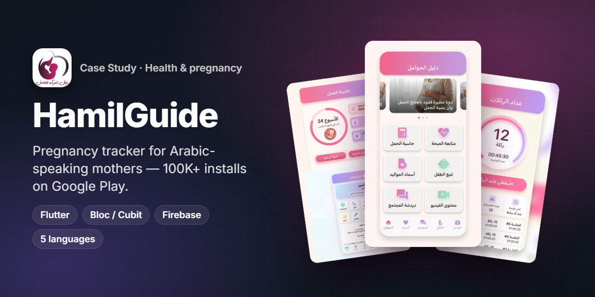
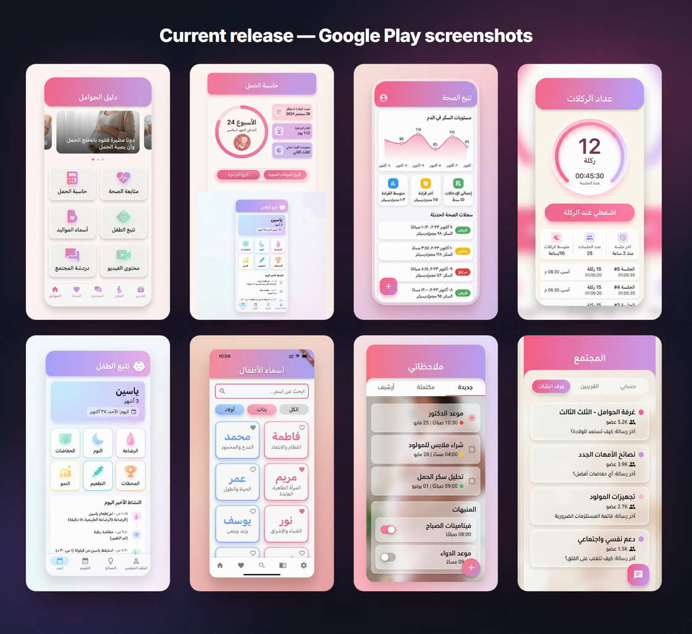
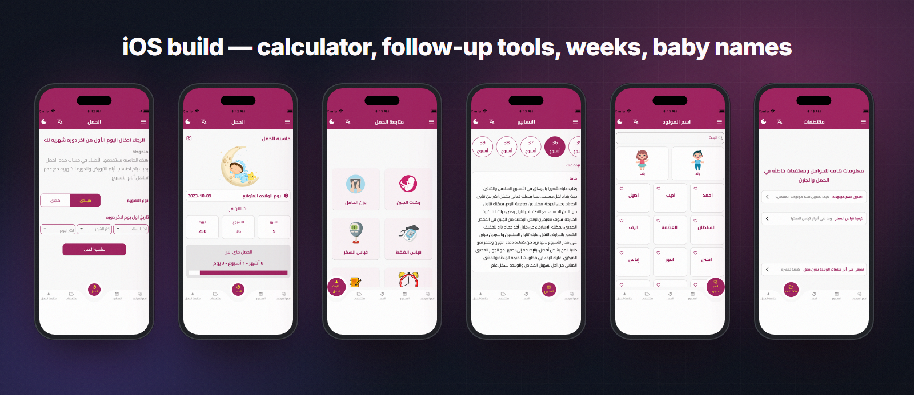
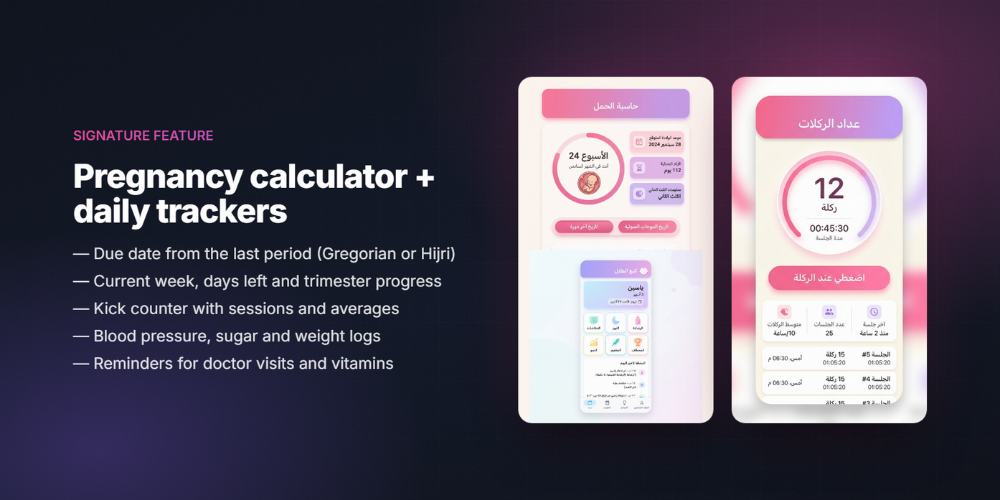
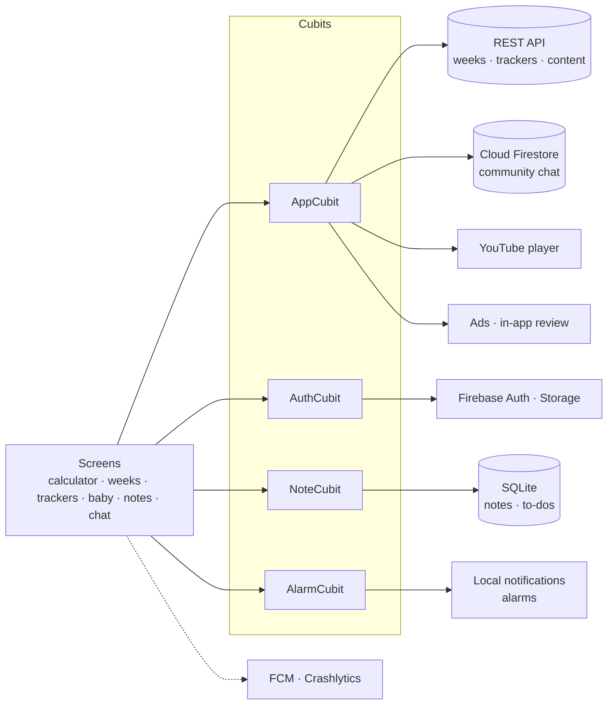

<h1 align="center">HamilGuide · دليل الحوامل</h1>

<b>A pregnancy companion for Arabic-speaking mothers — due-date calculator, week-by-week guide, health trackers and baby tools. 100K+ installs.</b>

  
  
  
  
  
  

  
  

> ℹ️ Case study — the source code is proprietary to the client and is not included.

## Overview

**HamilGuide** (دليل الحوامل — "the pregnant woman's guide") helps expecting mothers follow their pregnancy day by day: when the baby is due, what is happening this week, how their blood pressure, sugar and weight are trending, how often the baby kicks — and, after birth, how the baby is feeding, sleeping and developing.

| | |
|---|---|
| **Audience** | Arabic-speaking mothers (Egypt, Gulf, wider MENA) — UI also in English, French, Spanish and German |
| **Platforms** | Android, iPhone and iPad from one Flutter codebase |
| **My role** | Flutter developer — full mobile delivery: features, Firebase integration, releases on both stores |
| **Timeline** | On the App Store since October 2022; continuously updated (store version 28.x) |

## The challenge

- **Medical dates are easy to get wrong.** Mothers need a due date they can trust, calculated the way doctors do it — and many users track dates in the **Hijri** calendar, not only Gregorian.
- **Too many apps for one journey.** Mothers were juggling a calculator, a notes app, reminders and forums. HamilGuide puts the tools in one place.
- **Health data has to be quick to log** — a kick session or a sugar reading should take seconds, and be there on the next visit to the doctor.
- **Free for users.** The product is ad-supported, so ads had to fit in without breaking the experience.

## Highlights

**🤰 Pregnancy**
- Due-date calculator from the first day of the last period — **Gregorian or Hijri**
- Current week / month / day, days remaining and trimester progress
- Week-by-week guide (weeks 1–40) about the mother and the baby
- Tips, warning signs and common pregnancy myths; curated video library (YouTube)

**📈 Health trackers**
- **Kick counter** with timed sessions and averages
- Blood pressure, blood sugar and weight logs with charts and status labels
- Alarms / reminders for doctor visits, vitamins and medication (local notifications)

**👶 Baby & family**
- Baby-names explorer (boys / girls, meanings) with favourites
- Baby tracker after birth: feeding, health, language and social development, notes
- Notes and to-dos with *new / done / archived* tabs

**💬 Community & product**
- Community chat rooms backed by Cloud Firestore
- 5 languages (Arabic, English, French, Spanish, German) with `easy_localization`
- Phone, tablet and iPad layouts; dark-mode toggle
- In-app review prompts, share, push notifications, ad monetisation

## Screens

Current Google Play release: home, pregnancy calculator, health follow-up, kick counter, baby tracker, baby names, notes & reminders, community.

iOS build from the App Store listing: calculator input, result, follow-up tools, weeks guide, baby names and articles.

## Signature feature — pregnancy calculator + daily trackers

**How it works**
1. The mother picks a calendar type (**Gregorian / Hijri**) and enters the first day of her last period with year / month / day pickers (Hijri months are handled with `hijri_picker`).
2. The app computes the expected delivery date, the current week and day, the remaining time and the trimester, and shows them as a progress ring.
3. Daily trackers (kicks, pressure, sugar, weight) are posted to the HamilGuide REST API through Dio and listed back as a history with averages and status labels (normal / high / low).
4. Reminders are scheduled with local notifications, so they fire even without a network connection.

## Architecture & stack

| Layer | Tech |
|---|---|
| UI | Flutter, `sizer` + `flutter_screenutil` (phone / tablet), Google Fonts, Lottie, curved navigation bar, clay containers |
| State | `flutter_bloc` — App, Auth, Note and Alarm cubits |
| Networking | Dio — REST API for weeks content (per language), kicks, pressure, sugar and weight logs |
| Local data | `sqflite` (notes and to-dos), shared-preferences cache |
| Cloud | Firebase Auth, Cloud Firestore (chat), Firebase Storage, FCM, Crashlytics |
| Dates | Gregorian + Hijri calculation, `hijri_picker` |
| Media | `youtube_player_iframe`, cached network images |
| Notifications | `flutter_local_notifications` (reminders), FCM (push) |
| i18n | `easy_localization` — ar-EG, en-US, fr-FR, es-ES, de-DE |
| Growth | `in_app_review`, share, ad SDK, Shorebird code push |

## Engineering notes

- **Two calendars, one result.** The calculator accepts Gregorian or Hijri input; month lists for both calendars are localised, and the result screen always shows the due date, elapsed weeks / days and what is left.
- **Server-backed trackers, local notes.** Kicks, pressure, sugar and weight go to the backend so the history follows the user across devices, while personal notes and to-dos stay in on-device SQLite. Week-by-week content is fetched in the user's language (Arabic, English, French …).
- **Reliable reminders.** Doctor visits, vitamins and medication are scheduled as local notifications through a dedicated Alarm cubit, independent of the backend.
- **Five languages, RTL and LTR.** All strings (~350 keys) go through `easy_localization`; layouts switch direction with the locale.
- **Phone, tablet and iPad.** Sizing is relative (`sizer` / `screenutil`), and the same build ships iPad screenshots on the App Store.
- **Shipping fast at scale.** Crashlytics for crash monitoring and Shorebird for code-push patches let fixes reach a 100K+ user base without waiting for a full store review.

## Results

- **100K+ installs** on Google Play, rated **4.2★** (Google Play listing).
- **4.3★ from 88 ratings** on the App Store (Health & Fitness · Medical).
- Live on both stores since **2022**, still maintained (App Store version 28.2.1).

## بالعربي

**دليل الحوامل (HamilGuide)** تطبيق لمتابعة الحمل يومًا بيوم للأم العربية.
يحسب موعد الولادة من أول يوم في آخر دورة بالتقويم **الميلادي أو الهجري**، ويعرض الأسبوع الحالي والمتبقي ومعلومات كل أسبوع.
فيه عداد ركلات الجنين، ومتابعة الضغط والسكر والوزن، ومنبهات لمواعيد الطبيب والفيتامينات، وأسماء المواليد، ومتابعة الطفل بعد الولادة، ودردشة مجتمع.
متاح بخمس لغات على Android وiPhone وiPad، وتخطى **100 ألف تحميل** على Google Play بتقييم 4.2.
دوري: تطوير التطبيق بـ Flutter بالكامل — الميزات، تكامل Firebase، والنشر على المتجرين.

## Links

- Google Play — https://play.google.com/store/apps/details?id=com.dalil.elhwamelss
- App Store — https://apps.apple.com/app/id6443834135

---
<h3 align="center">Built by Mahmoud Shaker — Senior Flutter Engineer</h3>

  
  
  
  
  
  
  

